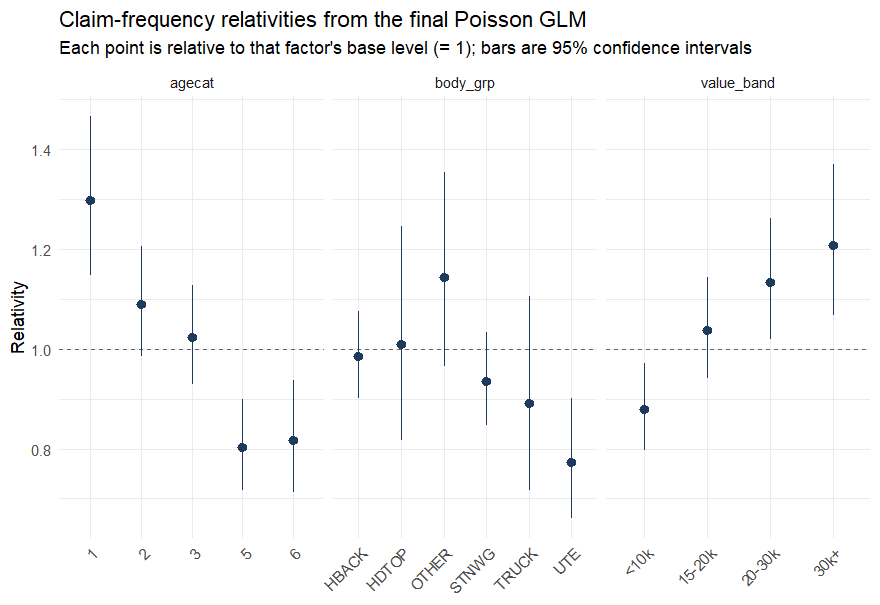
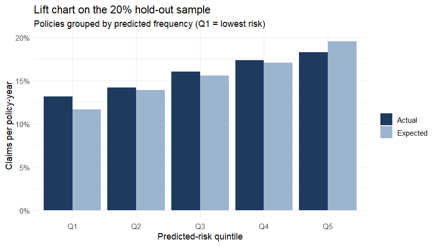

# Motor Claim Frequency Modelling (Poisson GLM in R)

How often do motor insurance policyholders claim, and which driver and vehicle characteristics change that?
This project builds a **claim-frequency model** of the kind used by pricing actuaries, and turns it into
**rating relativities** (premium multipliers).

**Full analysis with code and charts → [analysis.md](analysis.md)**



## Data

`dataCar` from the R package [`insuranceData`](https://cran.r-project.org/package=insuranceData):
**67,856 one-year vehicle policies (2004–05)**, about 31,800 policy-years of exposure and 4,937 claims
(de Jong & Heller, *Generalized Linear Models for Insurance Data*, 2008).

## Method

1. **Data preparation:** remove policies with a zero vehicle value, band vehicle value, group rare body types,
   and set each factor's base level to its highest-exposure level.
2. **One-way analysis:** observed frequency (claims ÷ exposure) by each factor.
3. **Poisson GLM** with a log link and a `log(exposure)` offset.
4. **Overdispersion check:** Pearson χ²/df ≈ 1.42, so variables are selected with **quasi-Poisson F-tests**
   (using the Pearson dispersion), and the **negative binomial** model is compared.
5. **Relativities** with 95% confidence intervals.
6. **Validation** on a 20% hold-out sample: hold-out deviance and a lift chart.
7. **Illustrative pure premiums:** frequency × average claim cost.

## Key findings

| Finding | Result |
|---|---|
| Factors kept | Driver age band, vehicle value band, body type |
| Factors dropped (not significant once overdispersion is allowed for) | Vehicle age, area, gender |
| Youngest drivers vs base (age band 4) | **1.30×** claim frequency (95% CI 1.15–1.47) |
| Oldest two age bands | about **0.80×** |
| Vehicle value | rises steadily from **0.88×** (<10k) to **1.21×** (30k+) |
| Utility vehicles (utes) vs sedans | **0.77×** |
| Poisson vs negative binomial | NB fits better by AIC, but relativities differ by at most 0.004, so the simpler Poisson model is kept |
| Hold-out check | 975.5 expected vs 991 actual claims (within 2%) |



## What I learned

* Frequency must be measured **per unit of exposure**: the offset term handles policies that were in force
  for only part of the year.
* **Overdispersion doesn't change the estimates, but it does change the conclusions.** Under the plain Poisson
  model, several factors looked significant that weren't once the extra variation was allowed for.
* The common shortcut `drop1(..., test = "F")` estimates dispersion from the deviance, which is badly
  misleading for sparse claim counts. The F-tests here use the Pearson dispersion instead.
* A lift chart shows more than "is the model good": here it shows the relativities are slightly too extreme,
  which credibility weighting or a penalised GLM would fix.

## Limitations and next steps

* Add a **Gamma GLM for claim severity** to get a full frequency × severity price.
* Test **interactions** (e.g. driver age × vehicle value).
* Apply **credibility weighting or regularisation** to the relativities.

## How to run

```r
source("install.R")                 # installs the required packages
rmarkdown::render("analysis.Rmd")   # recreates analysis.md and the figures
```

Built with R 4.6, using the packages `insuranceData`, `dplyr`, `tidyr`, `ggplot2`, `MASS`, `scales` and `rmarkdown`.

---
*Author: [Hemant Pareek](https://github.com/hemantpareek-02) · Aspiring actuarial analyst (IAI: ACET → CS1)*
