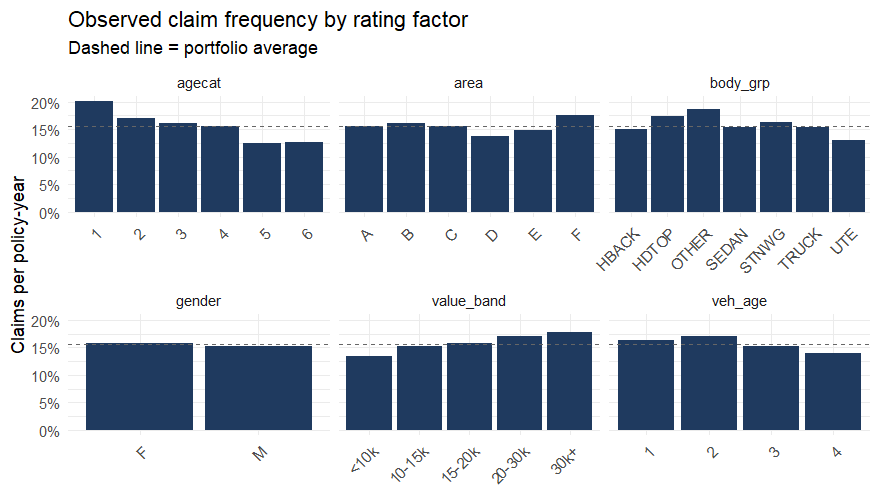
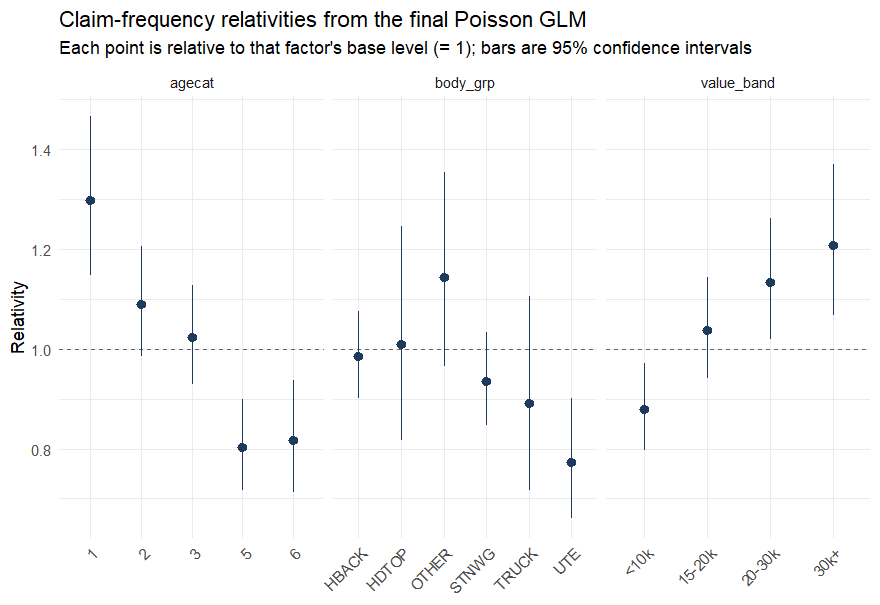
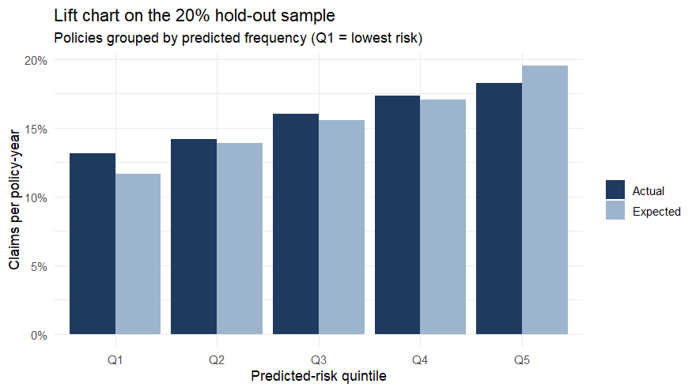

Motor Claim Frequency Modelling with a Poisson GLM
================
Hemant Pareek

- [1. Business question](#1-business-question)
- [2. Data](#2-data)
- [3. Exploratory analysis: observed claim
  frequency](#3-exploratory-analysis-observed-claim-frequency)
- [4. The model: Poisson GLM with an exposure
  offset](#4-the-model-poisson-glm-with-an-exposure-offset)
- [5. Results: rating relativities](#5-results-rating-relativities)
- [6. Validation on unseen data](#6-validation-on-unseen-data)
- [7. From frequency to an illustrative pure
  premium](#7-from-frequency-to-an-illustrative-pure-premium)
- [8. Limitations and next steps](#8-limitations-and-next-steps)
- [Reproducibility](#reproducibility)

## 1. Business question

A motor insurer charges each policyholder a premium that should reflect
their expected claims cost. Expected claims cost per policy-year is
usually split into two parts:

$$\text{Pure premium} = \underbrace{\text{Claim frequency}}_{\text{claims per policy-year}} \times \underbrace{\text{Claim severity}}_{\text{average cost per claim}}$$

This project models the **frequency** part: *which driver and vehicle
characteristics change how often claims happen, and by how much?* The
output is a set of **rating relativities** (multipliers) like those a
pricing actuary would use to build a rating table.

## 2. Data

`dataCar` (R package `insuranceData`) contains **67,856 one-year vehicle
insurance policies** written in 2004–05 (de Jong & Heller, *Generalized
Linear Models for Insurance Data*, 2008).

| Variable    | Meaning                                            |
|-------------|----------------------------------------------------|
| `numclaims` | Number of claims in the period (response)          |
| `exposure`  | Fraction of the year the policy was in force (0–1) |
| `agecat`    | Driver age band, 1 = youngest … 6 = oldest         |
| `veh_age`   | Vehicle age band, 1 = newest … 4 = oldest          |
| `veh_value` | Vehicle value in units of 10,000                   |
| `veh_body`  | Vehicle body type (sedan, hatchback, …)            |
| `area`      | Driver’s area of residence, A–F                    |
| `gender`    | Driver gender                                      |
| `claimcst0` | Total claim cost for the policy                    |

``` r
data(dataCar)
raw <- dataCar

data.frame(
  policies       = nrow(raw),
  policy_years   = round(sum(raw$exposure)),
  claims         = sum(raw$numclaims),
  overall_freq   = round(sum(raw$numclaims) / sum(raw$exposure), 4),
  zero_value_veh = sum(raw$veh_value == 0)
)
```

    ##   policies policy_years claims overall_freq zero_value_veh
    ## 1    67856        31801   4937       0.1552             53

### Data preparation

- **Remove 53 policies with a vehicle value of 0.** A car worth nothing
  is almost certainly a missing value.
- **Band vehicle value** into five groups. Relativities for bands are
  easier to read and use in a rating table than a single straight-line
  effect.
- **Group rare body types** (each under ~2% of policies) into `OTHER`,
  so no level is too small to estimate reliably.
- **Choose the base level for each factor** as the level with the most
  exposure. This is standard pricing practice: relativities are then
  measured against the most typical customer.

``` r
set_base <- function(f, w) relevel(f, ref = names(which.max(tapply(w, f, sum))))

motor <- raw %>%
  filter(veh_value > 0) %>%
  mutate(
    agecat   = factor(agecat),
    veh_age  = factor(veh_age),
    value_band = cut(veh_value, breaks = c(0, 1, 1.5, 2, 3, Inf),
                     labels = c("<10k", "10-15k", "15-20k", "20-30k", "30k+"), right = FALSE),
    body_grp = factor(ifelse(veh_body %in% c("SEDAN", "HBACK", "STNWG", "UTE", "TRUCK", "HDTOP"),
                             as.character(veh_body), "OTHER"))
  ) %>%
  select(numclaims, exposure, claimcst0, agecat, veh_age, value_band, body_grp, area, gender)

for (v in c("agecat", "veh_age", "value_band", "body_grp", "area", "gender")) {
  motor[[v]] <- set_base(motor[[v]], motor$exposure)
}
sapply(motor[c("agecat", "veh_age", "value_band", "body_grp", "area", "gender")], function(f) levels(f)[1])
```

    ##     agecat    veh_age value_band   body_grp       area     gender 
    ##        "4"        "3"   "10-15k"    "SEDAN"        "C"        "F"

## 3. Exploratory analysis: observed claim frequency

Claim frequency must be calculated as **claims ÷ exposure**, not claims
÷ policies, because many policies were in force for only part of the
year.

``` r
one_way <- function(var) {
  motor %>%
    group_by(level = .data[[var]]) %>%
    summarise(exposure = sum(exposure), claims = sum(numclaims), .groups = "drop") %>%
    mutate(factor = var, freq = claims / exposure)
}
eda <- bind_rows(lapply(c("agecat", "veh_age", "value_band", "area", "body_grp", "gender"), one_way))
eda$level <- as.character(eda$level)

ggplot(eda, aes(x = level, y = freq)) +
  geom_col(fill = "#1F3A5F") +
  geom_hline(yintercept = sum(motor$numclaims) / sum(motor$exposure), linetype = "dashed", colour = "grey40") +
  facet_wrap(~ factor, scales = "free_x", nrow = 2) +
  scale_y_continuous(labels = percent_format(accuracy = 1)) +
  labs(title = "Observed claim frequency by rating factor",
       subtitle = "Dashed line = portfolio average", x = NULL, y = "Claims per policy-year") +
  theme(axis.text.x = element_text(angle = 45, hjust = 1))
```

<!-- -->

**What stands out:** the youngest drivers (`agecat` 1) claim most often
and frequency falls steadily with age. Frequency also varies by vehicle
value and area. These are **one-way** views, though: factors overlap
(for example, young drivers may own cheaper cars), so we need a model
that looks at all factors together.

## 4. The model: Poisson GLM with an exposure offset

For policy $i$ with exposure $e_i$:

$$N_i \sim \text{Poisson}(\lambda_i e_i), \qquad \log(\lambda_i e_i) = \log(e_i) + \beta_0 + \sum_j \beta_j x_{ij}$$

- The **log link** makes the factors multiply, so $e^{\beta_j}$ is
  directly a **relativity**.
- $\log(e_i)$ is an **offset**, a term with its coefficient fixed at 1.
  A policy in force for half a year is expected to have half the claims.

``` r
full <- glm(numclaims ~ agecat + veh_age + value_band + body_grp + area + gender,
            family = poisson(link = "log"), offset = log(exposure), data = motor)
```

### Step 1: check for overdispersion first

The Poisson model assumes **variance = mean**. If claim counts vary more
than that (*overdispersion*), the coefficient estimates are still fine,
but the Poisson standard errors are **too small**. Factors would then
look more significant than they really are, so this has to be checked
**before** choosing variables.

``` r
pearson_ratio <- sum(residuals(full, type = "pearson")^2) / df.residual(full)
round(pearson_ratio, 3)
```

    ## [1] 1.42

A ratio of about 1.4 means **moderate overdispersion**. Two standard
fixes:

- **Quasi-Poisson:** same estimates, standard errors scaled up by
  $\sqrt{\phi}$ (about 1.19 here), and variables tested with F-tests
  instead of chi-square tests.
- **Negative binomial:** a different distribution with an extra
  parameter that allows variance \> mean.

### Step 2: variable selection with quasi-Poisson F-tests

For each factor, compare the full model with the model **without** that
factor. The F statistic is the drop in deviance per degree of freedom,
divided by the **Pearson** dispersion $\hat\phi$ of the full model.

> Note: `drop1(..., test = "F")` estimates dispersion from the residual
> *deviance* instead (about 0.37 here, because most policies have zero
> claims). That would make every factor look *more* significant, which
> is the opposite of what we want, so the tests are done explicitly with
> `anova()`.

``` r
full_q <- glm(formula(full), family = quasipoisson(link = "log"), offset = log(exposure), data = motor)
factors <- c("agecat", "veh_age", "value_band", "body_grp", "area", "gender")

f_tests <- do.call(rbind, lapply(factors, function(v) {
  reduced <- update(full_q, as.formula(paste(". ~ . -", v)))
  a <- anova(reduced, full_q, test = "F")          # uses the full model's Pearson dispersion
  data.frame(factor = v, df = a$Df[2], deviance_drop = round(a$Deviance[2], 2),
             F = round(a$F[2], 2), p_value = signif(a$`Pr(>F)`[2], 3))
}))
f_tests
```

    ##       factor df deviance_drop     F  p_value
    ## 1     agecat  5         84.71 11.93 1.45e-11
    ## 2    veh_age  3          3.71  0.87 4.56e-01
    ## 3 value_band  4         13.41  2.36 5.09e-02
    ## 4   body_grp  6         19.05  2.24 3.70e-02
    ## 5       area  5         10.73  1.51 1.83e-01
    ## 6     gender  1          1.10  0.78 3.78e-01

**Decision rule:** drop a factor if $p > 0.10$. A 10% threshold is
common at this exploratory stage, because a rating factor with a clear,
explainable trend is worth keeping even when the evidence is borderline.

``` r
drop_vars <- f_tests$factor[f_tests$p_value > 0.10]
keep_vars <- setdiff(factors, drop_vars)
cat("Dropped:", paste(drop_vars, collapse = ", "), "\nKept:   ", paste(keep_vars, collapse = ", "), "\n")
```

    ## Dropped: veh_age, area, gender 
    ## Kept:    agecat, value_band, body_grp

``` r
final_formula <- reformulate(keep_vars, response = "numclaims")
final   <- glm(final_formula, family = poisson(link = "log"),      offset = log(exposure), data = motor)
final_q <- glm(final_formula, family = quasipoisson(link = "log"), offset = log(exposure), data = motor)

# Joint test: do the dropped factors add anything once overdispersion is allowed for?
anova(final_q, full_q, test = "F")
```

    ## Analysis of Deviance Table
    ## 
    ## Model 1: numclaims ~ agecat + value_band + body_grp
    ## Model 2: numclaims ~ agecat + veh_age + value_band + body_grp + area + 
    ##     gender
    ##   Resid. Df Resid. Dev Df Deviance      F Pr(>F)
    ## 1     67787      25321                          
    ## 2     67778      25306  9   15.549 1.2166 0.2792

Vehicle value is the borderline case (p ≈ 0.05). It is kept because its
relativities rise steadily with value (see Section 5), and vehicle value
is a standard, easy-to-explain rating factor.

### Step 3: does the negative binomial tell a different story?

``` r
nb <- glm.nb(update(final_formula, . ~ . + offset(log(exposure))), data = motor)

data.frame(model = c("Poisson", "Negative binomial"),
           AIC = round(c(AIC(final), AIC(nb)), 1),
           theta = c(NA, round(nb$theta, 2)))
```

    ##               model     AIC theta
    ## 1           Poisson 34774.9    NA
    ## 2 Negative binomial 34738.0  2.27

``` r
cmp <- data.frame(term = names(coef(final))[-1],
                  poisson = exp(coef(final))[-1],
                  negbin  = exp(coef(nb))[names(coef(final))[-1]], row.names = NULL)
cat("Largest difference between Poisson and negative binomial relativities:",
    round(max(abs(cmp$poisson - cmp$negbin)), 3), "\n")
```

    ## Largest difference between Poisson and negative binomial relativities: 0.004

The negative binomial fits a little better by AIC, which confirms the
overdispersion. But its **relativities are almost identical** to the
Poisson ones. So the rating table keeps the Poisson estimates, which are
simpler, standard in pricing, and add up exactly to the observed total
claims. Confidence intervals use the **quasi-Poisson** standard errors,
so they allow for the extra variation.

## 5. Results: rating relativities

``` r
ci <- suppressMessages(confint.default(final_q))   # quasi-Poisson SEs
rel <- data.frame(term = names(coef(final)), relativity = exp(coef(final)),
                  lower = exp(ci[, 1]), upper = exp(ci[, 2]), row.names = NULL) %>%
  filter(term != "(Intercept)") %>%
  mutate(factor = sub("^(agecat|veh_age|value_band|body_grp|area|gender).*", "\\1", term),
         level  = sub("^(agecat|veh_age|value_band|body_grp|area|gender)", "", term))

knitr::kable(rel %>% select(factor, level, relativity, lower, upper), digits = 3,
             caption = "Relativities vs base level (95% confidence intervals, quasi-Poisson standard errors)")
```

| factor     | level  | relativity | lower | upper |
|:-----------|:-------|-----------:|------:|------:|
| agecat     | 1      |      1.298 | 1.147 | 1.467 |
| agecat     | 2      |      1.090 | 0.986 | 1.206 |
| agecat     | 3      |      1.024 | 0.930 | 1.127 |
| agecat     | 5      |      0.803 | 0.716 | 0.900 |
| agecat     | 6      |      0.817 | 0.712 | 0.936 |
| value_band | \<10k  |      0.879 | 0.796 | 0.971 |
| value_band | 15-20k |      1.037 | 0.940 | 1.143 |
| value_band | 20-30k |      1.134 | 1.019 | 1.262 |
| value_band | 30k+   |      1.209 | 1.067 | 1.370 |
| body_grp   | HBACK  |      0.985 | 0.901 | 1.075 |
| body_grp   | HDTOP  |      1.009 | 0.817 | 1.245 |
| body_grp   | OTHER  |      1.143 | 0.965 | 1.355 |
| body_grp   | STNWG  |      0.936 | 0.847 | 1.034 |
| body_grp   | TRUCK  |      0.890 | 0.717 | 1.106 |
| body_grp   | UTE    |      0.772 | 0.662 | 0.902 |

Relativities vs base level (95% confidence intervals, quasi-Poisson
standard errors)

``` r
base_freq <- exp(coef(final)[["(Intercept)"]])
cat("Base claim frequency (base level of every factor):", round(base_freq, 4), "claims per policy-year\n")
```

    ## Base claim frequency (base level of every factor): 0.1569 claims per policy-year

``` r
ggplot(rel, aes(x = level, y = relativity)) +
  geom_hline(yintercept = 1, linetype = "dashed", colour = "grey40") +
  geom_pointrange(aes(ymin = lower, ymax = upper), colour = "#1F3A5F") +
  facet_wrap(~ factor, scales = "free_x") +
  labs(title = "Claim-frequency relativities from the final Poisson GLM",
       subtitle = "Each point is relative to that factor's base level (= 1); bars are 95% confidence intervals",
       x = NULL, y = "Relativity") +
  theme(axis.text.x = element_text(angle = 45, hjust = 1))
```

<!-- -->

**How to read this:** a relativity of 1.25 means that level is expected
to claim **25% more often** than the base level, with everything else
held the same.

## 6. Validation on unseen data

To check that the model predicts rather than just memorises, refit it on
a random 80% of policies and test it on the other 20%.

``` r
idx   <- sample(seq_len(nrow(motor)), size = round(0.8 * nrow(motor)))
train <- motor[idx, ]
test  <- motor[-idx, ]

fit_tr  <- glm(final_formula, family = poisson, offset = log(exposure), data = train)
null_tr <- glm(numclaims ~ 1, family = poisson, offset = log(exposure), data = train)

test$expected <- predict(fit_tr, newdata = test, type = "response")
test$exp_null <- predict(null_tr, newdata = test, type = "response")

pois_dev <- function(y, mu) 2 * sum(ifelse(y > 0, y * log(y / mu), 0) - (y - mu))
data.frame(
  test_deviance_null  = round(pois_dev(test$numclaims, test$exp_null), 1),
  test_deviance_model = round(pois_dev(test$numclaims, test$expected), 1),
  actual_claims       = sum(test$numclaims),
  expected_claims     = round(sum(test$expected), 1)
)
```

    ##   test_deviance_null test_deviance_model actual_claims expected_claims
    ## 1             5160.9              5143.3           991           975.5

The **lift chart** ranks test policies by predicted frequency, splits
them into five equal-exposure groups, and compares actual with expected
claims. A good model shows a clear upward slope, with actual close to
expected.

``` r
test <- test %>%
  mutate(pred_freq = expected / exposure) %>%
  arrange(pred_freq) %>%
  mutate(group = cut(cumsum(exposure) / sum(exposure), breaks = seq(0, 1, 0.2),
                     labels = paste0("Q", 1:5), include.lowest = TRUE))

lift <- test %>%
  group_by(group) %>%
  summarise(Actual = sum(numclaims) / sum(exposure), Expected = sum(expected) / sum(exposure), .groups = "drop") %>%
  tidyr::pivot_longer(-group, names_to = "type", values_to = "freq")

ggplot(lift, aes(group, freq, fill = type)) +
  geom_col(position = "dodge") +
  scale_fill_manual(values = c(Actual = "#1F3A5F", Expected = "#9DB4CF")) +
  scale_y_continuous(labels = percent_format(accuracy = 1)) +
  labs(title = "Lift chart on the 20% hold-out sample",
       subtitle = "Policies grouped by predicted frequency (Q1 = lowest risk)",
       x = "Predicted-risk quintile", y = "Claims per policy-year", fill = NULL)
```

<!-- -->

**Reading the lift chart:** actual frequency rises steadily from the
lowest- to the highest-risk group, so the model does rank risk
correctly. It is slightly **too extreme at both ends**: it
under-predicts the safest group and over-predicts the riskiest. That’s a
common sign that some relativities partly reflect noise. In practice an
actuary would pull them towards 1, using credibility weighting or a
penalised (regularised) GLM.

## 7. From frequency to an illustrative pure premium

As a simple stand-in for a severity model, use the portfolio **average
cost per claim**, then multiply by each profile’s predicted frequency.

``` r
severity <- sum(motor$claimcst0) / sum(motor$numclaims)

profiles <- data.frame(
  profile    = c("Youngest drivers, hatchback worth 10-15k", "Typical: age band 4, sedan worth 10-15k", "Oldest drivers, sedan worth under 10k"),
  agecat     = c("1", levels(motor$agecat)[1], "6"),
  veh_age    = c("1", levels(motor$veh_age)[1], "4"),
  value_band = c("10-15k", levels(motor$value_band)[1], "<10k"),
  body_grp   = c("HBACK", levels(motor$body_grp)[1], "SEDAN"),
  area       = c("C", levels(motor$area)[1], "C"),
  gender     = c("M", levels(motor$gender)[1], "F"),
  exposure   = 1
)
for (v in c("agecat", "veh_age", "value_band", "body_grp", "area", "gender")) {
  profiles[[v]] <- factor(profiles[[v]], levels = levels(motor[[v]]))
}
profiles$frequency    <- predict(final, newdata = profiles, type = "response")
profiles$pure_premium <- profiles$frequency * severity

knitr::kable(profiles %>% select(profile, frequency, pure_premium), digits = c(0, 4, 0),
             caption = paste0("Average cost per claim used: ", round(severity)))
```

| profile                                  | frequency | pure_premium |
|:-----------------------------------------|----------:|-------------:|
| Youngest drivers, hatchback worth 10-15k |    0.2004 |          378 |
| Typical: age band 4, sedan worth 10-15k  |    0.1569 |          296 |
| Oldest drivers, sedan worth under 10k    |    0.1126 |          212 |

Average cost per claim used: 1886

## 8. Limitations and next steps

- **Severity is a flat average.** A proper price needs a separate
  severity model (for example a Gamma GLM on claim cost), because
  expensive cars cost more to repair.
- **One year of data from one market** (2004–05). The relativities show
  the method, not current prices.
- **No interactions tested** (for example age × vehicle value). These
  are a natural next step.
- A real rating table would also add expenses, profit and reinsurance
  costs, and smooth relativities so neighbouring bands don’t jump
  around.

## Reproducibility

``` r
sessionInfo()$R.version$version.string
```

    ## [1] "R version 4.6.1 (2026-06-24 ucrt)"
